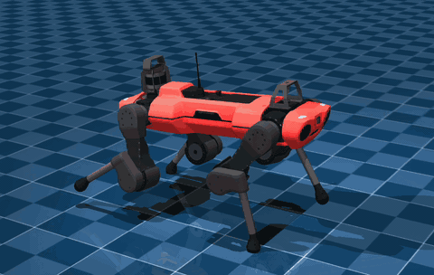
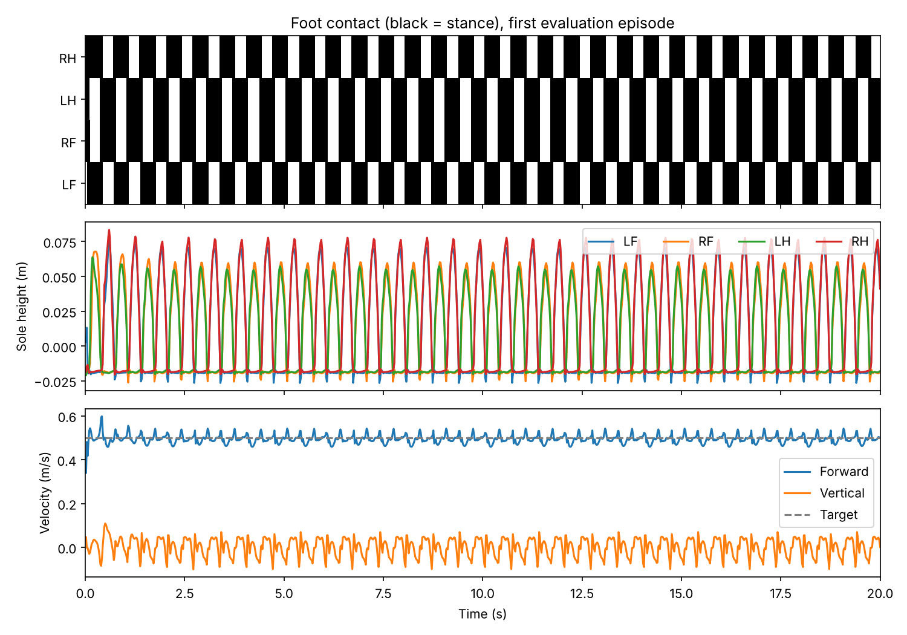

# ANYmal C trotting with PPO



A simulated ANYmal C learns to trot at 0.5 m/s in MuJoCo, trained with PPO (Stable-Baselines3).
A phase-based reward sets the footfall pattern: the diagonal leg pairs (LF+RH, RF+LH) alternate.
The policy outputs the 12 joint position targets directly.

## Results

Deterministic evaluation, 5 episodes of 20 s on a held-out seed (123):

| Forward speed (target 0.5 m/s) | Gait-pattern match | Flight phase | Episodes completed |
| :---: | :---: | :---: | :---: |
| 0.49 m/s | 99–100 % | 0 % | 5 / 5 |



Trained for 10M steps with 8 parallel environments in under an hour on a MacBook Air CPU
([training curves](anymal_gait_logs/training_metrics.png)).

## Run

```sh
pip install -r requirements.txt
python -m unittest test_anymal_gait -v           # 14 tests
mjpython anymal_check.py                          # watch the trained policy (use python on Linux)
python train_anymal_improved.py evaluate --checkpoint anymal_gait_logs/ppo_anymal.zip
python train_anymal_improved.py train --log-dir runs/new   # train from scratch
```

## Files

| | |
| --- | --- |
| `anymal_env_improved.py` | Gymnasium environment: observations, gait targets, rewards |
| `train_anymal_improved.py` | Training, playback and evaluation |
| `anymal_check.py` | Viewer for the trained policy |
| `test_anymal_gait.py` | Tests |
| `anymal_gait_logs/` | Trained policy, normalization statistics, training log |

The gait reward is inspired by [periodic reward composition](https://arxiv.org/abs/2011.01387).
The robot model is from [MuJoCo Menagerie](https://github.com/google-deepmind/mujoco_menagerie) (BSD-3-Clause).
